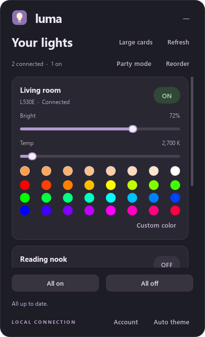
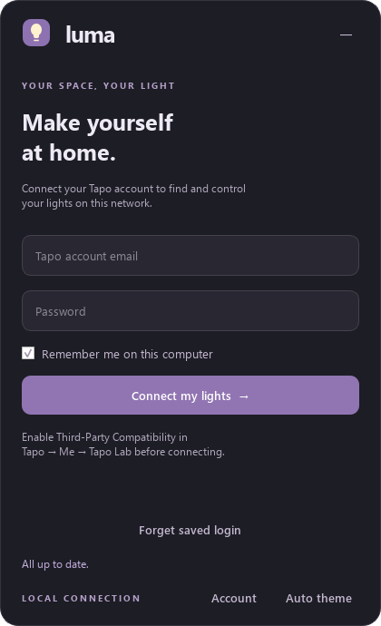

# Luma — a local tray controller for Tapo lights

Luma is a small Windows tray app for TP-Link Tapo **smart bulbs and light
strips**. It discovers them on your local network, signs in once, and gives
you fast power/brightness/color/temperature controls from a popup anchored to
its tray icon — no cloud round-trip, no separate mobile app required once
you're on the same Wi-Fi.



Everything runs locally: after your one-time Tapo account login, control
traffic goes straight to each bulb over your LAN using the same local
protocol the official Tapo app uses (via [python-kasa](https://github.com/python-kasa/python-kasa)).
Luma never talks to TP-Link's cloud to control a light.

## Where this fits in the Tapo ecosystem

TP-Link's Tapo brand covers a lot more than lights — smart plugs and power
strips, security cameras and video doorbells, robot vacuums, and
motion/contact sensors all carry the Tapo name and live in the same mobile
app and cloud account.

**Luma only supports Tapo bulbs and light strips** (the L5xx/L9xx families).
That's a deliberate scope choice, not a current limitation waiting on a
driver:

- **Plugs and power strips** speak the same local protocol family
  (`python-kasa` already supports them) and would be a natural extension —
  contributions welcome, see below.
- **Cameras, video doorbells, and robot vacuums** use entirely different,
  mostly cloud-dependent protocols that `python-kasa` doesn't implement at
  all. Supporting those would mean a different integration, not just a new
  device filter here.
- **Sensors and hubs** are outside what a light-control tray app is for.

If you're looking for whole-ecosystem control (plugs, cameras, vacuums, all
in one place), look at [Home Assistant's TP-Link integration](https://www.home-assistant.io/integrations/tplink/)
instead — Luma is intentionally smaller and more focused than that.

## Features

- Lives in the Windows notification area only — no taskbar window. Left-click
  the tray icon to open the popup; click outside or press <kbd>Esc</kbd> to
  dismiss it.
- Sign in once with your Tapo account; Luma discovers reachable bulbs and
  light strips on your active network and authenticates to each one locally.
  Discovery re-runs every minute; visible controls refresh every 15 seconds.
- Saved login goes into Windows Credential Manager — never stored in the
  project or a plaintext settings file. "Forget saved login" removes it.
- Per-light controls: power, brightness, a white-temperature slider plus
  eight quick shades (2500K–6500K, each swatch tinted to its real blackbody
  color), 24 full-saturation color swatches, and a custom color picker.
- Three ways to lay out the light list — **Large cards** (everything open),
  **Small cards** (compact two-column grid with a Details expander) — pick
  whichever fits how many lights you have; the choice is remembered.
- **Reorder**: a dedicated page to set your own priority order per light
  (▲▼), remembered by the light's MAC address across accounts and networks.
- **Party mode**: randomizes every online, color-capable light's color on a
  timer (0.5s–5s, right-click to change it) — synced, all lights at once.
- **Light / Dark / Auto** theme, Auto tracking Windows' own setting live. The
  tray icon itself dims when every light is off and glows when one is on.
- Launch-at-login support via a Windows Startup shortcut.

## Screenshots

| Sign in | Lights |
|---|---|
|  |  |

## Requirements

- Windows 10/11
- A Tapo account, with **Tapo app → Me → Tapo Lab → Third-Party
  Compatibility** enabled (this is what switches bulb discovery from the
  unsupported legacy protocol to the supported one)
- Python 3.11+ (for building/running from source; the packaged app still
  needs Python installed since `Luma.exe` is a launcher, not a bundled
  interpreter — see **Build**, below)

## Install / Build

```powershell
python -m venv .venv
.\.venv\Scripts\python.exe -m pip install -r requirements-desktop.txt
.\build.ps1
```

`build.ps1` compiles `dist\Luma\Luma.exe` — a small native (C++) launcher, not
a bundled Python/Qt binary. On launch it starts `tray_app.py` under this
project's own `.venv`, so keep the `.venv` folder and the source files in
place relative to `dist\Luma\Luma.exe`. This design deliberately avoids
PyInstaller-style Qt DLL bundling, which is fragile across machines; the
tradeoff is that `dist\Luma` isn't a copy-anywhere portable folder — it needs
this checkout's `.venv` alongside it.

Building `Luma.exe` itself requires a C/C++ toolchain — a
[MSYS2 UCRT64](https://www.msys2.org/) install with `g++`/`windres` on
`PATH` (or edit the `$compilerRoot` path at the top of `build.ps1`).

Alternatively, double-click `Luma.vbs` to run straight from the `.venv`
without building anything.

Run the backend test suite with:

```powershell
.\.venv\Scripts\python.exe -m unittest -v test_backend
```

`tray_app.py --preview` renders the interface with sample devices and saves
`preview.png` / `preview-login.png` — normal app usage never uses sample
data.

Launch at login: put a shortcut to `dist\Luma\Luma.exe` in the Windows
Startup folder (`shell:startup`).

## Command-line controller

`control.py` is a standalone script for scripting/debugging a single bulb
without the tray app:

```powershell
.\.venv\Scripts\python.exe control.py discover
.\.venv\Scripts\python.exe control.py --host 192.168.1.110 interactive
```

Commands: `on`, `off`, `brightness 1..100`, `white 2500..6500`,
`color HUE SATURATION` (0..360, 0..100), `status`, `quit`. Credentials are
entered interactively and never saved; `KASA_USERNAME`/`KASA_PASSWORD`
environment variables are supported for scripting.

## Known limits

- Windows only (the tray launcher and Credential Manager integration are
  Windows-specific).
- Local network control only — a light on a different network or VLAN can't
  be listed or controlled.
- No HomeKit, Matter, or Home Assistant bridge built in. Home Assistant's
  TP-Link integration plus its HomeKit Bridge can expose a bulb to Apple Home
  today; a real Matter bridge (e.g. [canonical/matter-bridge-tapo](https://github.com/canonical/matter-bridge-tapo))
  is a separate, unfinished effort upstream and isn't wired in here.

## Contributing

Issues and PRs are welcome — plug/power-strip support (via `python-kasa`,
which already talks to them), additional presets, and Linux/macOS support
(the tray/credential-storage code is Windows-specific today) are the most
obvious gaps. Please run `test_backend.py` before submitting a PR.

## License

MIT — see [LICENSE](LICENSE).
